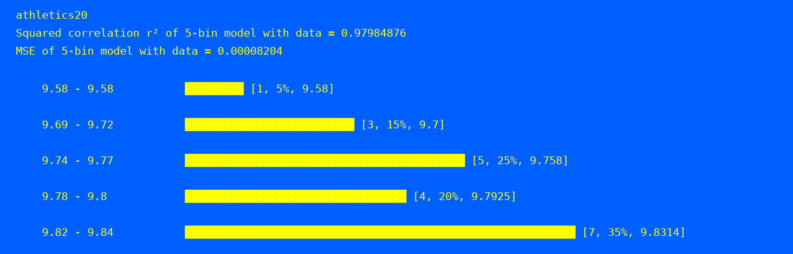
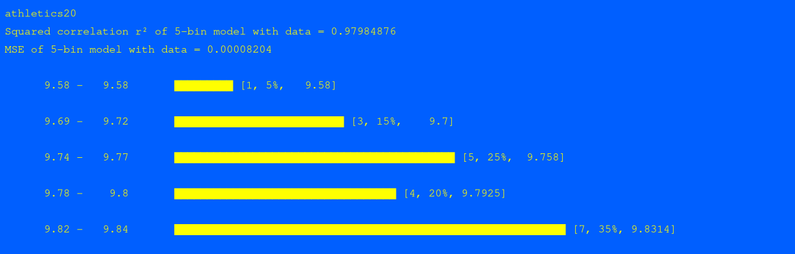
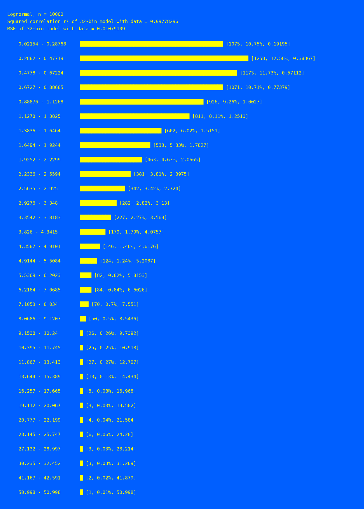

# lex1dx

lex1dx is a fast 1-D k-means clustering library: it splits a set of numbers into k contiguous bins with least squared error. Uses include scalar quantization, binning and histogram design.

It has a C++17 core, Python and R bindings to that core, and a Scala port:

- **C++**: the core library and a command-line tool (`lex1dx_dump`).
- **Python**: the `lex1dx` package for PyPI, which wraps the C++ core.
- **R**: the `lex1dx` package for CRAN, which compiles the same C++ core.
- **Scala**: a JVM port of the same algorithm with the same options, in `scala/`.

All four share one API: `cluster(x, k)` with optional `mode`, `sig`, `M`, `weights` and `solver`. Python, R and Scala bundle two example datasets. Python and R also have `histogram()` and `bin_table()`.

The method is described in the paper [LEX: Fast scalar quantization by grouping and local exchanges](https://doi.org/10.5281/zenodo.24543220) (Sriram, 2026).

Full API docs with examples are in [python/README.md](https://github.com/nsram/lex1dx/blob/main/python/README.md) (the PyPI page), [r/README.md](https://github.com/nsram/lex1dx/blob/main/r/README.md) and the R vignette, and [scala/README.md](https://github.com/nsram/lex1dx/blob/main/scala/README.md).

## Defaults

The default method is the tuned pipeline.

It sorts the data (and canonicalizes `-0` to `+0`).

Optional significant-digit grouping can be turned on with `sig`, an integer in 0..9. `sig = 0` (the default) keeps full precision, so only exact ties are merged. `mode = "sig5"` is an alias for `sig = 5`.

If grouping leaves fewer than k groups while the data have at least k distinct values, lex1dx adds one digit at a time, up to 15, and then falls back to the raw atoms. `Result.sig` reports the digit count actually used.

`mode = "exact"` skips Collapse and runs the chosen solver on all atoms.

Optional `weights` give each value a nonnegative weight. Unique values with their counts as weights give the same bins, SSE and centers as the expanded data.

Collapse uses a 0.75-quantile batch rule and finishes with a heap once at most 16384 merges remain.

The Collapse target is `M = max(4096, 32k)`.

The dynamic program on those M groups uses one of two exact solvers, chosen with `solver`:

- `"wilber"` (default) is a weighted wilber-interp DP, derived from Grønlund's kmeans1d (commit `585386d`) with a weighted interval-cost patch. It runs in roughly O(kN) time.
- `"ckmeans"` is the original LEX Fisher DP with divide and conquer, roughly O(kN log N). It follows the conventions of Ckmeans.1d.dp but is independent code.

Both are exact and, when Wilber returns, give the same partition up to floating-point ties. On some inputs Wilber's λ search can fail (an empty interval). The cause is collinear SSE*(k), e.g. regular grids or equally spaced values with equal counts, not ties. lex1dx then uses the Fisher / ckmeans solver, which is also exact. If that fallback's back-pointer table would exceed 2 GiB (possible in mode="exact" when D is large), lex1dx does not allocate the table and raises an error suggesting mode="tuned" or a smaller k. `Result.solver_used` is `"wilber"` or `"ckmeans"` and records which DP actually ran (when the DP is skipped, it mirrors the requested solver). Use the default. Use `"ckmeans"` as a cross-check, or when you want the classic Fisher DP. A CI test checks that both give the same partition on athletics20 at k = 5.

Refine is unchanged in role: it locally improves the cuts.

k larger than the number of atoms is clamped to that number.

## Build and use (C++)

From the repository root, with CMake 3.21+ and a C++17 compiler:

```
cmake -S . -B build -DCMAKE_BUILD_TYPE=Release
cmake --build build --config Release
ctest --test-dir build -C Release --output-on-failure
```

Link the `lex1dx` library and include `<lex1dx/lex1dx.hpp>`:

```cpp
#include <lex1dx/lex1dx.hpp>
lex1dx::Result r = lex1dx::cluster(values, 64);                 // tuned, default M
lex1dx::Options o;
o.sig = 5;
lex1dx::Result s = lex1dx::cluster(values, 64, o);              // 5-significant-digit grouping
o.mode = lex1dx::Mode::Exact;
o.solver = lex1dx::Solver::Ckmeans;
lex1dx::Result e = lex1dx::cluster(values, 64, o);
```

`Result` holds `bounds`, `sizes`, `centers`, `upper`, `sse`, `D`, `Dprime`, and `assign(x)`.

The `lex1dx_dump` tool prints bounds, centers, and SSE for a little-endian float64 file:

```
./build/lex1dx_dump tuned data.f64 64
```

## Build and use (Scala)

Scala 3.3 and sbt 1.10, from the `scala/` directory:

```
sbt test
```

```scala
import lex1dx.{Lex, Options, Mode, Solver, Datasets}
val x = Datasets.load("athletics20")
val r = Lex.cluster(x, 4)
val s = Lex.cluster(x, 4, Options(sig = 5))
val e = Lex.cluster(x, 4, Options(mode = Mode.Exact, solver = Solver.Ckmeans))
```

## Build and use (Python)

From the `python/` directory, with a C++17 compiler and CMake 3.21+:

```
pip install .
pip install pytest
pytest
```

```python
import numpy as np
import lex1dx
x = lex1dx.datasets.load("athletics20")
r = lex1dx.cluster(x, 4)                          # tuned, default M
s = lex1dx.cluster(x, 4, sig=5)                   # group to 5 significant digits
e = lex1dx.cluster(x, 4, mode="exact", solver="ckmeans")
w = lex1dx.cluster(vals, 4, weights=counts)
```

`mode="sig5"` is an alias for `sig=5`. `sig` is an integer in 0..9. 0 is full precision.
`M=None` (the default) uses `default_M(k) = max(4096, 32 * k)`.
`solver` is `"wilber"` (default) or `"ckmeans"`.

## Build and use (R)

From the `r/` directory, with a C++17 compiler. `configure` copies the C++ core into `src/`. Run `sh tools/sync_core.sh` before `R CMD build` as well:

```
sh tools/sync_core.sh
R CMD build .
R CMD check --no-manual --no-vignettes lex1dx_0.1.4.tar.gz
```

```r
library(lex1dx)
x <- load_dataset("athletics20")
r <- cluster(x, 4L)                               # tuned, default M
s <- cluster(x, 4L, sig = 5L)                     # group to 5 significant digits
e <- cluster(x, 4L, mode = "exact", solver = "ckmeans")
w <- cluster(vals, 4L, weights = counts)
```

`mode = "sig5"` is an alias for `sig = 5`. `sig` is an integer in 0..9. 0 is full precision.
`M = NULL` (the default) uses `default_M(k) = max(4096, 32 * k)`.
`solver` is `"wilber"` (default) or `"ckmeans"`.

## Histogram

`histogram()` in Python and R draws the fitted bins as a horizontal table, one row per bin, from the lowest bin at the top.

Each row shows the bin's range, a bar proportional to its count (or weight), and `[n, pct%, mean]`. The header gives r² and MSE for the k-bin model.

```python
r = lex1dx.cluster(x, 5)
lex1dx.histogram(r, x, title="athletics20")       # draw only; no file
lex1dx.histogram(r, x, file="lex1dx_histogram.png", title="athletics20")
rows = lex1dx.bin_table(r, x)                     # (lo, hi, n, pct, mean) per bin
```

Python needs matplotlib for `histogram()` (`pip install lex1dx[plot]`). R uses base graphics. `theme = "light"` gives grey bars on white. The default blue theme follows the 2024 Scala audio figures. `bin_table()` returns the same rows as data (a data frame in R).

athletics20, k = 5, Python:



athletics20, k = 5, R:



Lognormal sample, n = 10000, k = 32, Python:



## Results (v7 Mac pack)

On the v7 scaling pack, a post-sort comparison against Grønlund wilber-interp on the raw points gave speedups up to 156× (sig5) and 37× (tuned), with REE at most 0.0056% on all 270/270 cells.

Those times exclude the sort, because both methods need the same sorted input.

Those figures come from the `bot_v7_scaling_mac_pack` Mac run (270 cells, all ok).

## Example data

Two men's 100 m timing samples are bundled for tests and examples:
`athletics20` (20 times) and `worldathletics-mens-100m-2379` (2,379 times).

Source: World Athletics 100m all-time lists, retrieved January 2024.

Only the time column is kept. Athlete names and other fields are not included.

Sample Data Attribution: The sample 100m timing datasets (top 20 performances and 2379 all time bests) contain historical athletic performance records compiled from publicly available statistics published by World Athletics (https://worldathletics.org/). These datasets are provided strictly as static benchmark/example inputs for testing and demonstrating the algorithms in this package. This project is not affiliated with, endorsed by, or sponsored by World Athletics.

The precision examples use synthetic lognormal data generated in code with a fixed seed. See the Python and R READMEs.

Worked outputs are in `examples/cluster_athletics.py`, `r/inst/examples/cluster_athletics.R`,
and `docs/examples_output.md` / `docs/examples_output_r.md`.

## Citation

If you use lex1dx, please cite the paper:

- Sriram, N. (2026). LEX: Fast scalar quantization by grouping and local exchanges. Preprint, Zenodo. https://doi.org/10.5281/zenodo.24543220

Software and data:

- lex1dx (all versions): https://doi.org/10.5281/zenodo.24544281
- lex1dx v0.1.4: https://doi.org/10.5281/zenodo.24607940
- lex1dx v0.1.3: https://doi.org/10.5281/zenodo.24572680
- lex1dx-paper v1.0.0 (scripts, data, figures and tables for the paper): https://doi.org/10.5281/zenodo.24544241

lex1dx targets a 0.01% relative-excess-SSE (REE) tolerance, so its defaults and algorithms differ from the earlier exact-quality reference, [lex1d](https://github.com/nsram/lex1d).

## Attribution

lex1dx is MIT licensed (see `LICENSE`).

The wilber DP is derived from kmeans1d by Allan Grønlund, commit `585386d4678000691706acdb954911be8fea1c5c`, also MIT. See `NOTICE` and `third_party/kmeans1d/`.

The `ckmeans` solver is our own implementation of the Fisher (1958) dynamic program in the form described by Wang and Song (2011) for Ckmeans.1d.dp. No Ckmeans.1d.dp code is included.

- Fisher, W. D. (1958). On grouping for maximum homogeneity. *Journal of the American Statistical Association*, 53(284), 789–798.
- Wang, H. and Song, M. (2011). Ckmeans.1d.dp: Optimal k-means clustering in one dimension by dynamic programming. *The R Journal*, 3(2), 29–33.
