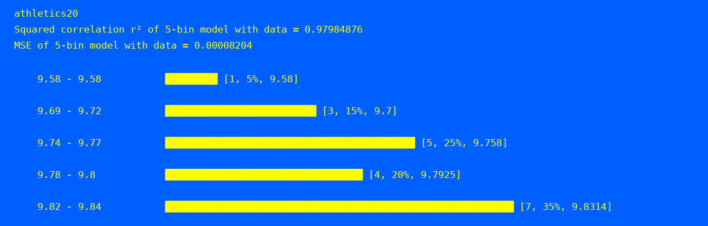
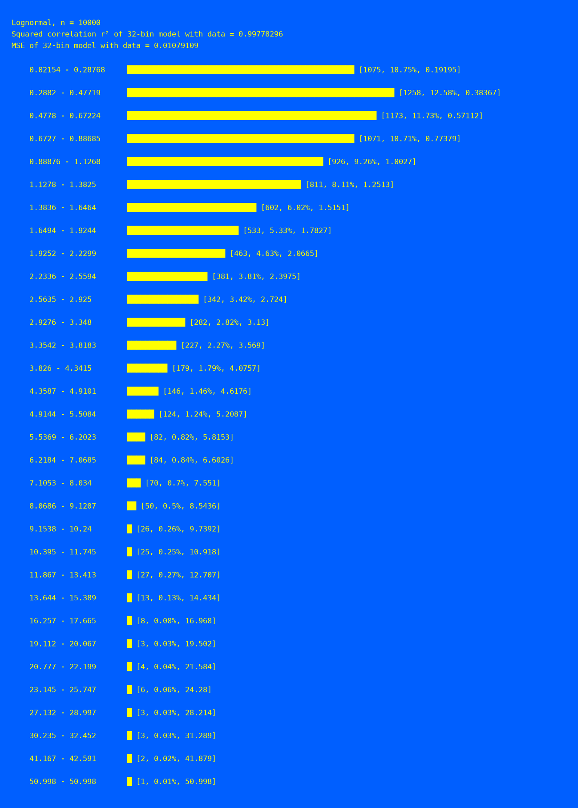

# lex1dx

lex1dx is fast 1-D k-means clustering. It partitions a one-dimensional array into k contiguous bins of the sorted values, for scalar quantization, binning and histogram design.

It targets a 0.01% relative-excess-SSE (REE) tolerance.

The C++17 core is also used by the [R](https://github.com/nsram/lex1dx/tree/main/r) binding.

A [Scala](https://github.com/nsram/lex1dx/tree/main/scala) port of the same algorithm runs on the JVM with no C++ dependency.

The source repository is [github.com/nsram/lex1dx](https://github.com/nsram/lex1dx).

## Install

From PyPI:

```sh
pip install lex1dx
pip install lex1dx[plot]   # optional, for histogram()
```

From a repository checkout, at the repository root:

```sh
pip install .
pip install pytest
pytest
```

## Quick start

`athletics20` is 20 men's 100 m times, in seconds, with 12 distinct values.

```python
import numpy as np
import lex1dx

x = lex1dx.datasets.load("athletics20")
r = lex1dx.cluster(x, 4)
print(list(r.bounds))
print(r.sse)
print(list(r.assign([9.58, 9.76, 9.84, 10.0])))
```

That call uses the default tuned pipeline.

The result has bounds `[0, 1, 4, 11, 20]`.

The bin sizes are `[1, 3, 7, 9]`.

The centers are approximately `[9.580000, 9.700000, 9.765714, 9.824444]`.

The SSE is `0.00399365079365`.

`assign` maps `9.58`, `9.76`, `9.84`, and `10.0` to bins `[0, 2, 3, 3]`.

`D` is 12 and `Dprime` is 12.

`sig` is 0, which means full precision.

`presorted` is true because the file is already sorted.

On this data the default result matches `mode="exact"` with either solver, so the REE versus exact is 0.

## cluster arguments

```python
lex1dx.cluster(x, k, *, mode="tuned", sig=None, M=None, tolerance=1e-11,
               weights=None, solver="wilber")
```

`x` is a one-dimensional finite numeric array.

`k` is the requested number of bins.

If `k` is larger than the number of atoms, it is clamped to that number.

For example, `athletics20` holds 20 men's 100 m times but only 12 distinct values, because of ties:

```python
x = lex1dx.datasets.load("athletics20")
r = lex1dx.cluster(x, 20)  # ask for 20 bins
r.k    # 12: one bin per distinct value
r.sse  # 0.0: every bin holds a single value
```

### mode

`mode="tuned"` is the default pipeline.

It sorts, optionally groups, collapses to `M` groups, runs a DP, and refines the cuts.

`mode="sig5"` is an alias for `sig=5`.

`mode="exact"` skips Collapse.

The chosen solver then runs on the atoms, after optional grouping.

On `athletics20` with `k=4`, both `solver="wilber"` and `solver="ckmeans"` under `mode="exact"` give the same bounds and the same SSE `0.00399365079365`.

### sig

`sig` is an integer in 0..9.

0 means full precision (no grouping).

1..9 groups values to that many significant digits.

`sig=None` follows `mode`: 5 when `mode="sig5"`, otherwise 0.

Values of 10 or more are rejected.

Use `sig=0` for full precision.

If grouping at the requested `sig` yields fewer than `k` groups, and the raw data has at least `k` distinct values, precision is raised one digit at a time (up to 15, then raw distinct-value atoms) so `k` is kept.

This is the same k-preserving fallback as v0.1.0.

`Result.sig` is the sig actually used.

It is 0 if the fallback reached raw atoms.

`Result.Dprime` is the number of groups after that grouping.

A constructed example makes the fallback visible.

Four tight groups around 0, 1.000012, 1.000017, and 2 would give only three groups at 5 digits.

With `sig=5` and `k=4`, the fallback raises precision to 6.

The result has `k=4`, `Dprime=4`, and `sig=6`.

The bounds are `[0, 50, 100, 150, 200]`.

### M and default_M

`M=None` uses `default_M(k) = max(4096, 32 * k)`.

`default_M(4)` and `default_M(64)` are 4096.

`default_M(256)` is 8192.

`M` is ignored when `mode="exact"`.

On `athletics20` the default `M` is larger than the 12 distinct times, so Collapse does not reduce the atoms.

On the 2,379-row list, `k=8` with default `M` matches exact (SSE `0.709129743721`, REE 0).

With `M=8`, the SSE is `0.718184561908` and the REE versus exact is `1.27689%`.

With `M=32`, the REE is `0.0820787%`.

### tolerance

`tolerance` is the Refine move threshold.

The default is `1e-11`.

A move is applied only if it lowers SSE by more than this tolerance times the size of its terms.

### weights

`weights` is an optional non-negative finite vector of the same length as `x`.

`None` is the unweighted solver.

The result SSE and centers are then weighted.

`sizes` remain element counts.

Equal times already act as integer counts.

Clustering the 12 distinct `athletics20` times with counts `[1, 2, 1, 1, 3, 1, 1, 1, 2, 1, 4, 2]` as weights matches clustering the expanded 20 values.

The centers, SSE, and per-bin weight mass agree at `k=4`.

A different weighting changes the partition.

Clustering those 12 distinct times with no weights (each time has weight 1) gives bounds `[0, 1, 4, 9, 12]` and SSE `0.00246666666667`.

Negative, non-finite, zero-total, or wrong-length weights are rejected.

### solver

`solver="wilber"` is the default.

It is the modified Grønlund kmeans1d wilber-interp DP.

`solver="ckmeans"` is the Fisher / ckmeans exact DP.

Both solvers are exact and give the same optimum.

Wilber is faster as k grows, because wilber-interp is O(k N) in style while ckmeans is a divide-and-conquer O(k N log N) DP.

ckmeans is the original LEX exact DP and serves as a cross-check.

On `athletics20` with `k=4` and `mode="exact"`, both solvers agree on SSE.

## Result and assign

The result has `bounds`, `sizes`, `centers`, `upper`, `sse`, `D`, `Dprime`, `sig`, `sweeps`, `moves`, and `presorted`.

`bounds` are `k + 1` cut indices into the sorted data.

Bin `i` holds sorted values from `bounds[i]` to `bounds[i+1]`.

`sizes` are element counts per bin.

`centers` are bin means (weighted means if weights were given).

`upper` is the largest raw value in each bin.

`sse` is the (weighted) sum of squared deviations from the bin means.

`r.k` is `min(requested k, atoms)`.

`r.assign(x)` returns the bin index for each value.

It chooses the first bin whose upper value is at least `x`, or the last bin if none is.

## Order independence

`athletics20` is already sorted, so `presorted` is true.

A shuffled copy gives the same bounds and the same SSE.

On the shuffled copy, `presorted` is false.


## Histogram

`histogram()` draws the fitted bins as a horizontal table, one row per bin, from the lowest bin at the top.

Each row shows the bin's minimum and maximum (5 significant digits), a bar proportional to the count, and `[n, pct%, mean]`.

The header reports r² = 1 - SSE/SST and MSE = SSE/N.

```python
x = lex1dx.datasets.load("athletics20")
r = lex1dx.cluster(x, 5)
lex1dx.bin_table(r, x)
lex1dx.histogram(r, x, file="lex1dx_histogram.png", title="athletics20")
```

The default theme is a blue background with yellow bars and monospace text.

Pass `theme="light"` for a white background with dark grey bars.

The default is `file=None`: draw on the current (or a new) figure, return the Axes, and write no file. Pass `file=` to write a PNG and return that path.

`histogram()` needs matplotlib. Install it with `pip install lex1dx[plot]`.

athletics20, k = 5:



Lognormal sample, n = 10000, k = 32:



## Example data

```python
lex1dx.datasets.names()
# ('athletics20', 'worldathletics-mens-100m-2379')
x = lex1dx.datasets.load("athletics20")
y = lex1dx.datasets.load("worldathletics-mens-100m-2379")
```

`athletics20` has 20 times from 9.58 to 9.84.

`worldathletics-mens-100m-2379` has 2,379 times from 9.58 to 10.30, with 58 distinct values.

The 20-row file is the prefix of the 2,379-row list.

Only the time column is kept.

Athlete names and other fields are not included.

Source: World Athletics 100m all-time lists, retrieved January 2024.

Sample Data Attribution: The sample 100m timing datasets (top 20 performances and 2379 all time bests) contain historical athletic performance records compiled from publicly available statistics published by World Athletics (https://worldathletics.org/). These datasets are provided strictly as static benchmark/example inputs for testing and demonstrating the algorithms in this package. This project is not affiliated with, endorsed by, or sponsored by World Athletics.

## Precision on a synthetic sample

Athletics times have two decimal places, so they do not show significant-digit grouping well.

The table below uses 10,000 lognormal draws in full double precision.

The generator is `numpy.random.default_rng(1).lognormal(size=10_000)`.

`k` is 8.

REE is relative excess SSE versus `cluster(..., mode="exact", solver="ckmeans")`.

The exact SSE is `2000.58997032`.

```python
import time
import numpy as np
import lex1dx

x = np.random.default_rng(1).lognormal(size=10_000)
k = 8
ex = lex1dx.cluster(x, k, mode="exact", solver="ckmeans")
print("sig  Dprime  SSE  REE")
for d in range(0, 10):
    r = lex1dx.cluster(x, k, sig=d)
    ree = 0.0 if ex.sse == 0 else (r.sse - ex.sse) / ex.sse * 100.0
    print(f"{d:3d}  {r.Dprime:6d}  {r.sse:.12g}  {ree:g}")
```

| sig | Dprime | SSE | REE |
|---:|---:|---:|---:|
| 0 | 10000 | 2000.58997032 | 0 |
| 1 | 31 | 2446.90052339 | 22.3089% |
| 2 | 255 | 2003.23173531 | 0.132049% |
| 3 | 1693 | 2000.59035628 | 1.92923e-05% |
| 4 | 6577 | 2000.58997032 | 0 |
| 5 | 9487 | 2000.58997032 | 0 |
| 6 | 9940 | 2000.58997032 | 0 |
| 7 | 9993 | 2000.58997032 | 0 |
| 8 | 9998 | 2000.58997032 | 0 |
| 9 | 10000 | 2000.58997032 | 0 |

`Dprime` is nondecreasing in `sig`.

`mode="sig5"` matches `sig=5` on this sample (`sig=5`, same SSE).

Worked scripts are in [`examples/cluster_athletics.py`](https://github.com/nsram/lex1dx/blob/main/examples/cluster_athletics.py).
