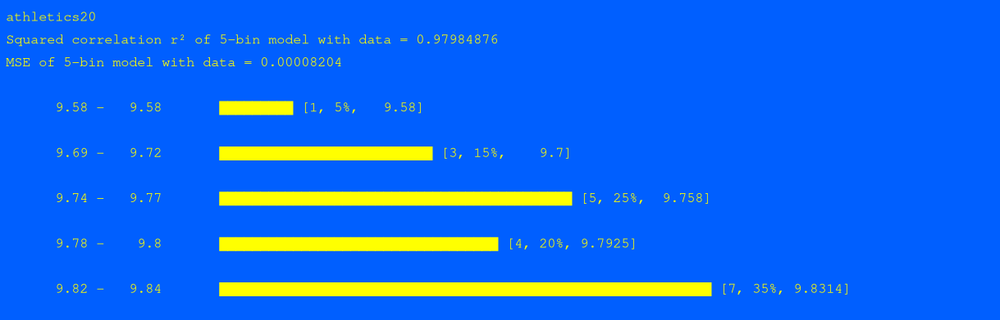
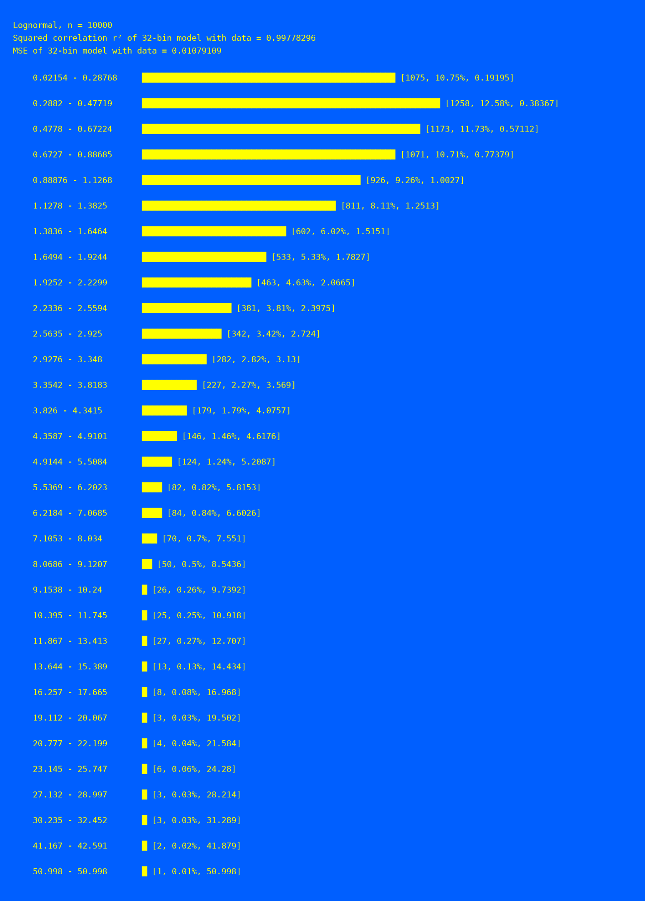

# lex1dx

lex1dx is fast 1-D k-means clustering. It partitions a numeric vector into k contiguous bins of the sorted values, for scalar quantization, binning and histogram design.

It targets a 0.01% relative-excess-SSE (REE) tolerance.

The C++17 core is also used by the [Python](https://github.com/nsram/lex1dx/tree/main/python) and [Scala](https://github.com/nsram/lex1dx/tree/main/scala) bindings.

The source repository is [github.com/nsram/lex1dx](https://github.com/nsram/lex1dx).

A longer worked document is in the package vignette `vignette("lex1dx")`.

## Install

From a repository checkout, in the `r/` directory:

```
sh tools/sync_core.sh
R CMD build .
R CMD INSTALL lex1dx_0.1.3.tar.gz
```

`configure` and `tools/sync_core.sh` copy the C++ core into `src/` so the package is self-contained.

## Quick start

`athletics20` is 20 men's 100 m times, in seconds, with 12 distinct values.

```r
library(lex1dx)
x <- load_dataset("athletics20")
r <- cluster(x, 4L)
r$bounds
r$sse
```

That call uses the default tuned pipeline.

The result has bounds `0, 1, 4, 11, 20`.

The bin sizes are `1, 3, 7, 9`.

The centers are approximately `9.580000, 9.700000, 9.765714, 9.824444`.

The SSE is `0.00399365079365`.

`D` is 12 and `Dprime` is 12.

`sig` is 0, which means full precision.

`presorted` is true because the file is already sorted.

On this data the default result matches `mode = "exact"` with either solver, so the REE versus exact is 0.

## cluster arguments

```r
cluster(x, k, mode = "tuned", sig = NULL, M = NULL, tolerance = 1e-11,
        weights = NULL, solver = "wilber")
```

`x` is a finite numeric vector.

`k` is the requested number of bins.

If `k` is larger than the number of atoms, it is clamped to that number.

On `athletics20`, `cluster(x, 20L)` returns 12 bins and SSE 0.

### mode

`mode = "tuned"` is the default pipeline.

It sorts, optionally groups, collapses to `M` groups, runs a DP, and refines the cuts.

`mode = "sig5"` is an alias for `sig = 5`.

`mode = "exact"` skips Collapse.

The chosen solver then runs on the atoms, after optional grouping.

On `athletics20` with `k = 4`, both `solver = "wilber"` and `solver = "ckmeans"` under `mode = "exact"` give the same bounds and the same SSE `0.00399365079365`.

### sig

`sig` is an integer in 0..9.

0 means full precision (no grouping).

1..9 groups values to that many significant digits.

`sig = NULL` follows `mode`: 5 when `mode = "sig5"`, otherwise 0.

Values of 10 or more are rejected.

Use `sig = 0` for full precision.

If grouping at the requested `sig` yields fewer than `k` groups, and the raw data has at least `k` distinct values, precision is raised one digit at a time (up to 15, then raw atoms) so `k` is kept.

This is the same k-preserving fallback as v0.1.0.

The result field `sig` is the sig actually used.

It is 0 if the fallback reached raw atoms.

`Dprime` is the number of groups after that grouping.

A constructed example makes the fallback visible.

Four tight groups around 0, 1.000012, 1.000017, and 2 would give only three groups at 5 digits.

With `sig = 5` and `k = 4`, the fallback raises precision to 6.

The result has 4 bins, `Dprime = 4`, and `sig = 6`.

The bounds are `0, 50, 100, 150, 200`.

### M and default_M

`M = NULL` uses `default_M(k) = max(4096, 32 * k)`.

`default_M(4L)` and `default_M(64L)` are 4096.

`default_M(256L)` is 8192.

`M` is ignored when `mode = "exact"`.

On `athletics20` the default `M` is larger than the 12 distinct times, so Collapse does not reduce the atoms.

On the 2,379-row list, `k = 8` with default `M` matches exact (SSE `0.709129743721`, REE 0).

With `M = 8`, the SSE is `0.718184561908` and the REE versus exact is `1.27689%`.

With `M = 32`, the REE is `0.0820787%`.

### tolerance

`tolerance` is the Refine move threshold.

The default is `1e-11`.

A move is applied only if it lowers SSE by more than this tolerance times the size of its terms.

### weights

`weights` is an optional non-negative finite vector of the same length as `x`.

`NULL` is the unweighted solver.

The result SSE and centers are then weighted.

`sizes` remain element counts.

Equal times already act as integer counts.

```r
tab <- table(x)
vals <- as.numeric(names(tab))
wts <- as.numeric(tab)
rw <- cluster(vals, 4L, weights = wts)
re <- cluster(x, 4L)
```

The centers, SSE, and per-bin weight mass agree at `k = 4`.

A different weighting changes the partition.

Clustering those 12 distinct times with no weights (each time has weight 1) gives bounds `0, 1, 4, 9, 12` and SSE `0.00246666666667`.

Negative, non-finite, zero-total, or wrong-length weights are rejected.

### solver

`solver = "wilber"` is the default.

It is the modified kmeans1d wilber-interp DP.

`solver = "ckmeans"` is the Fisher / ckmeans exact DP.

Both solvers are exact and give the same optimum.

Wilber is faster as k grows, because wilber-interp is O(k N) in style while ckmeans is a divide-and-conquer O(k N log N) DP.

ckmeans is the original LEX exact DP and serves as a cross-check.

On `athletics20` with `k = 4` and `mode = "exact"`, both solvers agree on SSE.

## The result and order independence

The result is a list with `bounds`, `sizes`, `centers`, `upper`, `sse`, `D`, `Dprime`, `sig`, `sweeps`, `moves`, and `presorted`.

`bounds` are `k + 1` cut indices into the sorted data.

Bin `i` holds sorted values from `bounds[i] + 1` to `bounds[i + 1]` in R's 1-based indexing of the sorted vector.

`sizes` are element counts per bin.

`centers` are bin means (weighted means if weights were given).

`athletics20` is already sorted, so `presorted` is true.

A shuffled copy gives the same bounds and the same SSE.

On the shuffled copy, `presorted` is false.


## Histogram

`histogram()` draws the fitted bins as a horizontal table, one row per bin, from the lowest bin at the top.

Each row shows the bin's minimum and maximum (5 significant digits), a bar proportional to the count, and `[n, pct%, mean]`.

The header reports r² = 1 - SSE/SST and MSE = SSE/N.

```r
x <- load_dataset("athletics20")
r <- cluster(x, 5L)
bin_table(r, x)
histogram(r, x, file = "lex1dx_histogram.png", title = "athletics20")
```

The default theme is a blue background with yellow bars and monospace text.

Pass `theme = "light"` for a white background with dark grey bars.

The default is `file = NULL`: draw to the current device and write no file. Pass `file =` to write a PNG.

athletics20, k = 5:



Lognormal sample, n = 10000, k = 32 (Python):



## Example data

```r
load_dataset()
# "athletics20" "worldathletics-mens-100m-2379"
x <- load_dataset("athletics20")
y <- load_dataset("worldathletics-mens-100m-2379")
```

`athletics20` has 20 times from 9.58 to 9.84.

`worldathletics-mens-100m-2379` has 2,379 times from 9.58 to 10.30, with 58 distinct values.

The 20-row file is the prefix of the 2,379-row list.

Only the time column is kept.

Athlete names and other fields are not included.

Source: World Athletics 100m all-time lists, retrieved January 2024.

Sample Data Attribution: The sample 100m timing datasets (top 20 performances and 2379 all time bests) contain historical athletic performance records compiled from publicly available statistics published by World Athletics (https://worldathletics.org/). These datasets are provided strictly as static benchmark/example inputs for testing and demonstrating the algorithms in this package. This project is not affiliated with, endorsed by, or sponsored by World Athletics.

## Precision on a synthetic sample

Athletics times have two decimal places, so they do not show significant-digit grouping well.

The table below uses 10,000 lognormal draws in full double precision.

The generator is `set.seed(1); x <- rlnorm(10000)`.

`k` is 8.

REE is relative excess SSE versus `cluster(..., mode = "exact", solver = "ckmeans")`.

The exact SSE is `1784.67877368`.

These draws are not the same as the Python `default_rng(1)` sample.

```r
set.seed(1)
x <- rlnorm(10000)
k <- 8L
ex <- cluster(x, k, mode = "exact", solver = "ckmeans")
for (d in 0:9) {
  r <- cluster(x, k, sig = d)
  ree <- if (ex$sse == 0) 0 else (r$sse - ex$sse) / ex$sse * 100
  cat(d, as.integer(r$Dprime), r$sse, ree, "\n")
}
```

| sig | Dprime | SSE | REE |
|---:|---:|---:|---:|
| 0 | 10000 | 1784.67877368 | 0 |
| 1 | 30 | 1970.04207511 | 10.3864% |
| 2 | 249 | 1788.29255976 | 0.202489% |
| 3 | 1726 | 1784.68558008 | 0.00038138% |
| 4 | 6619 | 1784.67877368 | 0 |
| 5 | 9477 | 1784.67877368 | 0 |
| 6 | 9956 | 1784.67877368 | 0 |
| 7 | 9998 | 1784.67877368 | 0 |
| 8 | 9999 | 1784.67877368 | 0 |
| 9 | 10000 | 1784.67877368 | 0 |

`Dprime` is nondecreasing in `sig`.

`mode = "sig5"` matches `sig = 5` on this sample (`sig = 5`, same SSE).

Worked scripts are in [`inst/examples/cluster_athletics.R`](https://github.com/nsram/lex1dx/blob/main/r/inst/examples/cluster_athletics.R).
