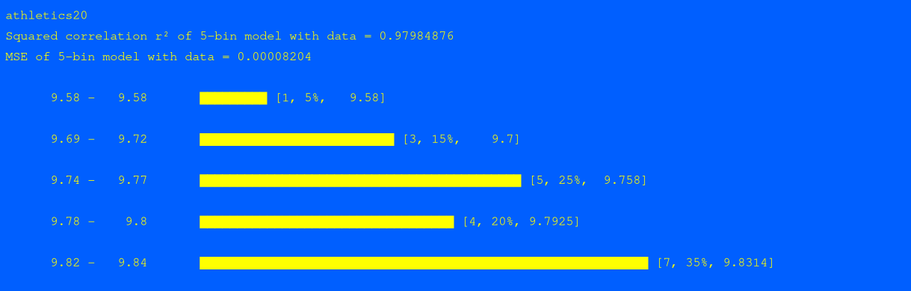

```{r, include = FALSE}
knitr::opts_chunk$set(
  collapse = TRUE,
  comment = "#>"
)
```

lex1dx partitions a numeric vector into k contiguous bins of the sorted values.

It targets a 0.01% relative-excess-SSE (REE) tolerance.

This vignette walks through `cluster()` on the bundled athletics times, then through a seeded synthetic sample that shows significant-digit grouping.

```{r setup}
library(lex1dx)
```

## Quick start

`athletics20` is 20 men's 100 m times, in seconds, with 12 distinct values.

```{r athletics20}
x <- load_dataset("athletics20")
length(x)
length(unique(x))
range(x)
r <- cluster(x, 4L)
r$bounds
r$sizes
r$centers
r$sse
r$D
r$Dprime
r$sig
r$presorted
```

That call uses the default tuned pipeline (`mode = "tuned"`).

On this data the default result matches `mode = "exact"` with either solver, so the REE versus exact is 0.

If `k` is larger than the number of atoms, it is clamped.

```{r clamp}
r20 <- cluster(x, 20L)
r20$k
r20$sse
```

## cluster arguments

```r
cluster(x, k, mode = "tuned", sig = NULL, M = NULL, tolerance = 1e-11,
        weights = NULL, solver = "wilber")
```

`x` is a finite numeric vector.

`k` is the requested number of bins.

### mode

`mode = "tuned"` is the default pipeline.

It sorts, optionally groups, collapses to `M` groups, runs a DP, and refines the cuts.

`mode = "sig5"` is an alias for `sig = 5`.

`mode = "exact"` skips Collapse.

The chosen solver then runs on the atoms, after optional grouping.

```{r exact-solvers}
ew <- cluster(x, 4L, mode = "exact", solver = "wilber")
ec <- cluster(x, 4L, mode = "exact", solver = "ckmeans")
identical(ew$bounds, ec$bounds)
ew$sse
ec$sse
```

### sig

`sig` is an integer in 0..9.

0 means full precision (no grouping).

1..9 groups values to that many significant digits.

`sig = NULL` follows `mode`: 5 when `mode = "sig5"`, otherwise 0.

Values of 10 or more are rejected.

Use `sig = 0` for full precision.

If grouping at the requested `sig` yields fewer than `k` groups, and the raw data has at least `k` distinct values, precision is raised one digit at a time (up to 15, then raw atoms) so `k` is kept.

This is the same k-preserving fallback as v0.1.0.

The result field `sig` is the sig actually used.

It is 0 if the fallback reached raw atoms.

`Dprime` is the number of groups after that grouping.

Four tight groups around 0, 1.000012, 1.000017, and 2 would give only three groups at 5 digits.

With `sig = 5` and `k = 4`, the fallback raises precision to 6.

```{r fallback}
xs <- c(rep(0, 50),
        1.000012 + 1e-10 * ((0:49) - 25),
        1.000017 + 1e-10 * ((0:49) - 25),
        rep(2, 50))
rf <- cluster(xs, 4L, sig = 5L)
c(k = rf$k, Dprime = rf$Dprime, sig = rf$sig)
rf$bounds
```

### M and default_M

`M = NULL` uses `default_M(k) = max(4096, 32 * k)`.

```{r default-M}
default_M(4L)
default_M(64L)
default_M(256L)
```

`M` is ignored when `mode = "exact"`.

On `athletics20` the default `M` is larger than the 12 distinct times, so Collapse does not reduce the atoms.

On the 2,379-row list, a small `M` raises the SSE.

```{r coarse-M}
y <- load_dataset("worldathletics-mens-100m-2379")
ex <- cluster(y, 8L, mode = "exact", solver = "ckmeans")
rd <- cluster(y, 8L)
r8 <- cluster(y, 8L, M = 8L)
r32 <- cluster(y, 8L, M = 32L)
ree <- function(r) if (ex$sse == 0) 0 else (r$sse - ex$sse) / ex$sse * 100
c(exact = ex$sse, default = rd$sse, M8 = r8$sse, M32 = r32$sse,
  ree_default = ree(rd), ree_M8 = ree(r8), ree_M32 = ree(r32))
```

### tolerance

`tolerance` is the Refine move threshold.

The default is `1e-11`.

A move is applied only if it lowers SSE by more than this tolerance times the size of its terms.

### weights

`weights` is an optional non-negative finite vector of the same length as `x`.

`NULL` is the unweighted solver.

The result SSE and centers are then weighted.

`sizes` remain element counts.

Equal times already act as integer counts.

Clustering the 12 distinct times with their counts as weights matches clustering the expanded 20 values.

```{r weights}
tab <- table(x)
vals <- as.numeric(names(tab))
wts <- as.numeric(tab)
rw <- cluster(vals, 4L, weights = wts)
re <- cluster(x, 4L)
all.equal(rw$centers, re$centers)
all.equal(rw$sse, re$sse)
# Per-bin weight mass from the unique-times weights vs expanded sizes:
mass_w <- vapply(seq_len(4), function(i) {
  sum(wts[(rw$bounds[i] + 1):rw$bounds[i + 1]])
}, numeric(1))
mass_w
re$sizes
```

A different weighting changes the partition.

Clustering those 12 distinct times with no weights (each time has weight 1) gives a different cut.

```{r unweighted-unique}
ru <- cluster(vals, 4L)
ru$bounds
ru$sse
```

Negative, non-finite, zero-total, or wrong-length weights are rejected.

### solver

`solver = "wilber"` is the default.

It is the modified kmeans1d wilber-interp DP.

`solver = "ckmeans"` is the Fisher / ckmeans exact DP.

Both solvers are exact and, when Wilber returns, give the same optimum (up to floating-point ties).

On some inputs Wilber's λ search can fail (an empty interval). The cause is collinear SSE*(k), e.g. regular grids or equally spaced values with equal counts, not ties. lex1dx then uses the Fisher / ckmeans solver, which is also exact. If that fallback's back-pointer table would exceed 2 GiB (possible in mode `"exact"` when D is large), lex1dx does not allocate the table and raises an error suggesting mode `"tuned"` or a smaller k. `solver_used` in the result is `"wilber"` or `"ckmeans"` and records which DP actually ran (when the DP is skipped, it mirrors the requested solver).

Wilber is faster as k grows, because wilber-interp is O(k N) in style while ckmeans is a divide-and-conquer O(k N log N) DP.

ckmeans is the original LEX exact DP and serves as a cross-check.

On `athletics20` with `k = 4` and `mode = "exact"`, both solvers agree on SSE.

## The result and order independence

The result is a list with `bounds`, `sizes`, `centers`, `upper`, `sse`, `D`, `Dprime`, `sig`, `sweeps`, `moves`, and `presorted`.

`bounds` are `k + 1` cut indices into the sorted data.

Bin `i` holds sorted values from `bounds[i] + 1` to `bounds[i + 1]` in R's 1-based indexing of the sorted vector.

`athletics20` is already sorted, so `presorted` is true.

A shuffled copy gives the same bounds and the same SSE.

```{r shuffle}
set.seed(1)
xs <- sample(x)
rs <- cluster(xs, 4L)
identical(rs$bounds, r$bounds)
all.equal(rs$sse, r$sse)
rs$presorted
```


## Histogram

`histogram()` draws the fitted bins as a horizontal table, one row per bin, from the lowest bin at the top.

Each row shows the bin's minimum and maximum (5 significant digits), a bar proportional to the count, and `[n, pct%, mean]`.

The header reports r² = 1 - SSE/SST and MSE = SSE/N.

```{r histogram, fig.show = "hide"}
r5 <- cluster(x, 5L)
bin_table(r5, x)
f <- tempfile(fileext = ".png")
histogram(r5, x, file = f, title = "athletics20")
```

The sample below is the same call on `athletics20` with k = 5.

```{r histogram-sample, echo = FALSE, out.width = "100%"}

```

The default theme is a blue background with yellow bars and monospace text.

Pass `theme = "light"` for a white background with dark grey bars.

The default is `file = NULL`: draw to the current device and write no file. Pass `file =` to write a PNG.

## Example data

```{r datasets}
load_dataset()
y <- load_dataset("worldathletics-mens-100m-2379")
length(y)
length(unique(y))
range(y)
```

The 20-row file is the prefix of the 2,379-row list.

Only the time column is kept.

Athlete names and other fields are not included.

Source: World Athletics 100m all-time lists, retrieved January 2024.

Sample Data Attribution: The sample 100m timing datasets (top 20 performances and 2379 all time bests) contain historical athletic performance records compiled from publicly available statistics published by World Athletics (https://worldathletics.org/). These datasets are provided strictly as static benchmark/example inputs for testing and demonstrating the algorithms in this package. This project is not affiliated with, endorsed by, or sponsored by World Athletics.

## Precision on a synthetic sample

Athletics times have two decimal places, so they do not show significant-digit grouping well.

The table below uses 10,000 lognormal draws in full double precision.

The generator is `set.seed(1); x <- rlnorm(10000)`.

`k` is 8.

REE is relative excess SSE versus `cluster(..., mode = "exact", solver = "ckmeans")`.

These draws are not the same as the Python `default_rng(1)` sample.

```{r precision, fig.show = "hide"}
set.seed(1)
z <- rlnorm(10000)
k <- 8L
exz <- cluster(z, k, mode = "exact", solver = "ckmeans")
exz$sse
tab <- do.call(rbind, lapply(0:9, function(d) {
  rz <- cluster(z, k, sig = d)
  ree <- if (exz$sse == 0) 0 else (rz$sse - exz$sse) / exz$sse * 100
  data.frame(sig = d, Dprime = as.integer(rz$Dprime),
             SSE = rz$sse, REE = ree)
}))
knitr::kable(tab, digits = 8)
```

`Dprime` is nondecreasing in `sig`.

`mode = "sig5"` matches `sig = 5` on this sample.

```{r sig5-alias}
s5 <- cluster(z, k, sig = 5L)
m5 <- cluster(z, k, mode = "sig5")
c(s5$sig, m5$sig)
all.equal(s5$sse, m5$sse)
```
